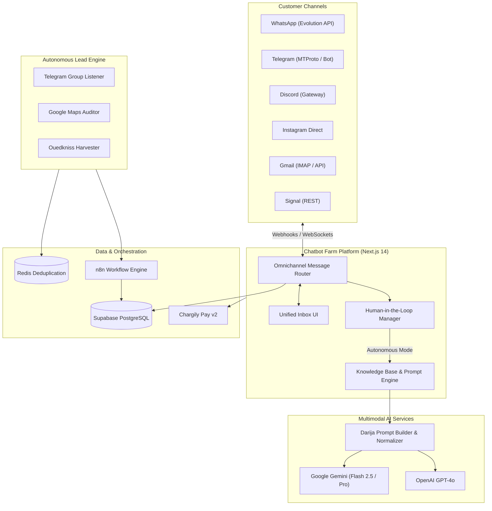

# 🌾 Chatbot Farm SaaS — Omnichannel AI Customer Support & Autonomous Lead Engine

<div align="center">

[](https://nextjs.org)
[](https://www.typescriptlang.org)
[](https://tailwindcss.com)
[](https://supabase.com)
[](https://n8n.io)
[](https://chargily.com)
[](LICENSE)

**An enterprise-grade, omnichannel conversational AI platform and automated B2B lead generation engine with native Algerian Darija & multilingual support.**

[Features](#-key-features) • [Architecture](#-system-architecture) • [Quick Start](#-quick-start) • [Environment Setup](#-environment-variables) • [Lead Engine](#-autonomous-lead-engine) • [API & Webhooks](#-api-endpoints--webhooks)

</div>

---

## 📖 Overview

**Chatbot Farm SaaS** is a comprehensive solution for modern commerce and enterprise support. It unifies customer interactions across **WhatsApp, Telegram, Discord, Instagram, Messenger, Gmail, and Signal** into a single, high-performance web console. Powered by Google Gemini and OpenAI with localized prompts (Algerian Darija, French, Modern Standard Arabic, English), it handles incoming customer inquiries, extracts structured order details, allows seamless human-agent takeover, and autonomously mines high-intent business leads.

---

## ✨ Key Features

- 💬 **Unified 3-Column Omnichannel Inbox**: Real-time message streaming, conversation search, channel badges, and audio voice note playback.
- 🤖 **Context-Aware AI Auto-Reply**: Dialect-tuned reasoning recognizing Algerian Darija slang, French commercial terminology, and Arabic queries.
- 🧑‍💻 **Human-in-the-Loop (HITL) Fallback**: Instant one-click AI pause/resume toggle with agent status indicators.
- 🗂️ **Customer CRM & Knowledge Base**: Attach custom FAQ documents, product catalogs, and dynamic pricing rules directly from the dashboard.
- 💳 **Chargily Pay v2 Integration**: Native Algerian payment checkout (EDAHABIA / CIB) with automated webhook verification.
- 🎯 **Autonomous Lead Generation Engine**:
  - **Active Intent**: Real-time Telegram community monitoring and Reddit keyword listeners.
  - **Passive Fit**: Google Maps place scrapers and Ouedkniss GraphQL harvesters.
  - **Redis Deduplication**: High-speed fingerprinting preventing duplicate outreach.
  - **n8n Automated Sequences**: Cold message scheduling, debounce windows, and CRM syncing.

---

## 🏛️ System Architecture



---

## 🚀 Quick Start

### 1. Prerequisites
- **Node.js**: v18.17+ or v20+
- **npm** or **pnpm**
- **Docker & Docker Compose** (for PostgreSQL / Redis / Evolution API)
- **Supabase Account** (or local Postgres instance)

### 2. Installation

```bash
# Clone the repository
git clone https://github.com/Maliksouhildev/chatbot-farm-saas.git
cd chatbot-farm-saas

# Install frontend dependencies
npm install

# Setup environment variables
cp .env.example .env.local
```

### 3. Run Development Server

```bash
npm run dev
```

Open [http://localhost:3000](http://localhost:3000) in your browser.

---

## 🔑 Environment Variables

Create `.env.local` in the root folder with the following keys:

```ini
# Supabase Configuration
NEXT_PUBLIC_SUPABASE_URL=https://your-project.supabase.co
NEXT_PUBLIC_SUPABASE_ANON_KEY=your-anon-key
SUPABASE_SERVICE_ROLE_KEY=your-service-role-key

# AI Model Credentials (BYOK or Server-wide)
GEMINI_API_KEY=AIzaSy...
OPENAI_API_KEY=sk-...
GROQ_API_KEY=gsk_...

# Payments (Chargily Pay v2)
CHARGILY_API_SECRET_KEY=test_sk_...
CHARGILY_WEBHOOK_SECRET=your_webhook_signature

# Evolution WhatsApp API
EVOLUTION_API_URL=http://localhost:8080
EVOLUTION_API_KEY=your_evolution_key

# Telegram MTProto (Optional Userbot)
TELEGRAM_API_ID=12345678
TELEGRAM_API_HASH=abcdef0123456789
```

---

## 🎯 Autonomous Lead Engine

The `lead-engine/` directory hosts autonomous Python microservices that harvest qualified local business leads:

```bash
cd lead-engine

# Start Redis & DB containers
docker-compose up -d

# Install Python requirements
pip install -r harvesters/requirements.txt

# Run Active Intent Listener
python harvesters/active_intent/telegram_listener.py

# Run Google Maps Auditor
python harvesters/passive_fit/gmaps_auditor.py
```

Automated n8n blueprints are included in `lead-engine/n8n_workflows/`:
1. `01_lead_ingestion_and_ai_scoring.json`: Ranks incoming leads based on budget and intent.
2. `02_telegram_hitl_approval_bot.json`: Sends hot leads to sales admins via Telegram buttons.
3. `03_omnichannel_outreach_and_debounce.json`: Dispatches scheduled follow-ups without spamming.
4. `04_midnight_batch_and_google_sheets.json`: Syncs daily summaries to Google Sheets.

---

## 📡 API Endpoints & Webhooks

| Endpoint | Method | Description |
|:---------|:-------|:------------|
| `/api/channels/[channelId]/send` | `POST` | Dispatches outbound message to specified channel |
| `/api/inbox/toggle-ai` | `POST` | Toggles autonomous AI auto-reply on/off for a conversation |
| `/api/inbox/simulate` | `POST` | Simulates customer conversations for prompt testing |
| `/api/webhooks/chargily` | `POST` | Verifies and clears EDAHABIA/CIB payment transactions |
| `/api/webhooks/meta` | `POST` | Ingestion webhook for Instagram / Messenger events |

---

## 🤝 Contributing & License

Pull requests are welcome! For major changes, please open an issue first to discuss the proposed change.

Distributed under the **MIT License**. Created & maintained by [Maliksouhildev](https://github.com/Maliksouhildev).
